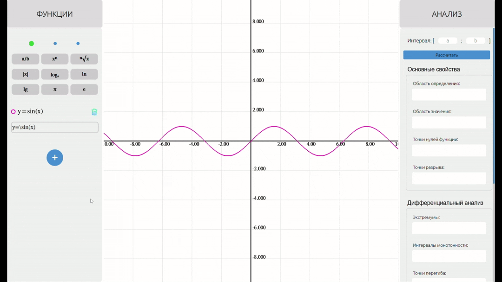
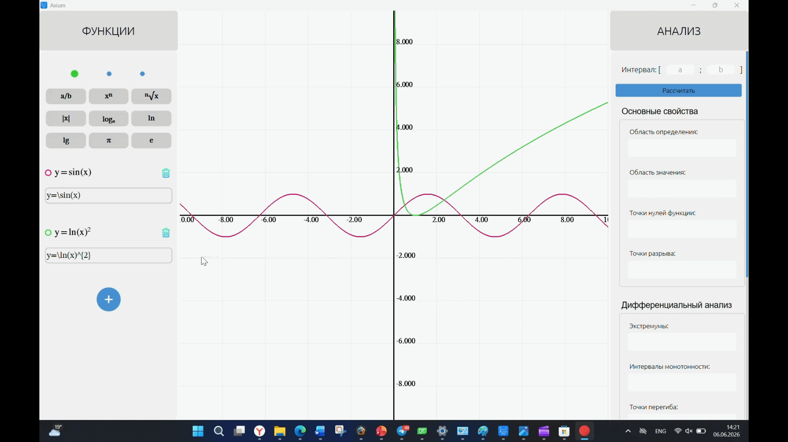
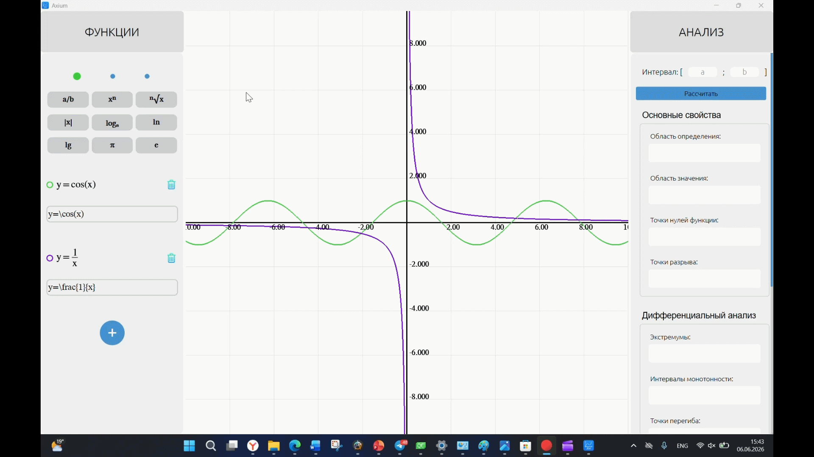

# Функциональное назначение программы

Программа предназначена для визуализации явно заданных пользовательских функций одной переменной и их исследования на основе интерактивных возможностей и численного анализа.

# Демонстрация работы

## Набор функции

## Изменение цвета функции

## Интерактив

## Численный анализ функции 

# Сборка и запуск

* Установите Qt Creator, Qt 6.5 и компилятор MSVC 2022.

* Склонируйте или скачайте репозиторий.

* Откройте файл axium.pro в Qt Creator.

* Выберите комплект сборки Qt 6.5 MSVC 2022 64-bit.

* Выполните настройку проекта и сборку (Build).

* Запустите приложение (Run).

Дополнительные библиотеки JKQtMathText и JKQtCommon включены в репозиторий и подключаются автоматически при настройке проекта.

# Руководство

# Условные обозначения

•	[Л] – щелчок левой кнопкой мыши,

•	[П] – щелчок правой кнопкой мыши,

•	[С] – щелчок средней кнопкой мыши,

•	[С↓] – прокрутка колеса мыши вниз,

•	[С↑] – прокрутка колеса мыши вверх,

•	[Δ] – перемещение мыши,

•	[Л+] – удержание левой кнопки мыши,

•	[П+] – удержание правой кнопки мыши,

•	[С+] – удержание средней кнопки мыши.

## Ввод функций
Ввод новой функции начинается с [Л] по соответствующему полю   левой панели.
Далее возможно 2 альтернативных варианта:

•	набор функции с клавиатуры по правилам:
Расширенная форма Бэкуса — Наура (EBNF):

    Formula     = Variable '=' Expr .      * Корневое правило *
    Expr    = Term { ('+' | '-') Term } * Parser::parse_expression() *
    Term    = Factor { '*' Factor } * Parser::parse_term() *
    Factor  = [ '+' | '-' ] Primary { '^' '{' Expr '}' } * Parser::parse_factor() *
    Primary = Number | Variable | Const | Function | '(' Expr ')' | '{' Expr '}' * Parser::parse_primary() *
    Function = FunctionName [ '^' '{' Expr '}' ] '(' Expr ')'
               | '\frac' '{' Expr '}' '{' Expr '}'
               | '\sqrt' [ '[' Expr ']' ] '{' Expr '}'
               | '\log_' '{' Expr '}' [ '^' '{' Expr '}' ] '(' Expr ')'
               | '\left' '|' Expr '\right' '|' *Parser::parse_function()*
    FunctionName ::= '\sin' | '\cos' | '\tan' | '\cot'
                   | '\arcsin' | '\arccos' | '\arctan' | '\textrm{arccot}'
                   | '\sinh' | '\cosh' | '\tanh' | '\coth'
                   | '\textrm{argsinh}' | '\textrm{argcosh}' | '\textrm{argtanh}'
                   | '\exp' | '\ln' | '\lg'
    Number      = digit { digit } [ '.' digit { digit } ]
    digit       = '0' | '1' | '2' | '3' | '4' | '5' | '6' | '7' | '8' | '9'
    Variable    = 'x' | 'y'
    Const       = '\pi' | '\e'

•	набор функции с помощью вкладок математических операторов. Для внесения оператора в текущую функцию необходимо сделать [Л] по нему. 

Для «обрамления» текущей записи математическим оператором необходимо выделить соответствующую область с помощью [Л+] и [Δ], а затем выбрать математический оператор.

Для продолжения печати с помощью клавиатуры нужно сделать [Л] по полю ввода. 

*Переключение между вкладками осуществляется [Л] по синей кнопке-кружочку, активная вкладка отображается в виде зеленой кнопки-кружочка!*

## Изменение цвета
Изменение цвета функции возможно с помощью [Л] по круглому значку рядом с целевой функцией. 

## Удаление функции

Удалить функцию можно c помощью выполнения [Л] по значку корзины рядом с целевой функцией. 

Вернуть функцию после удаления невозможно.

## Добавление функции
Добавить функцию можно c помощью выполнения [Л] по значку '+' внизу левой панели. 

Количество введённых функций неограниченно. Если введено более 3-х функций, перемещение вверх/вниз по панели возможно с помощью [С↑]/[С↓], либо с помощью [Л+]+[Δ] по ползунку.

## Перемещение вдоль функции
Перемещение осуществляется посредством [С+]+[Δ] в сторону, противоположную смещению области видимости. 

## Масштабирование функции
Для начала с помощью [Δ] необходимо выставить курсор для указания центра масштабирования. После этого увеличить/уменьшить масштаб относительно текущей точки возможно с помощью [С↑]/[С↓]. 

## Значение функции в точке
Возможно отображение значения функции в точке по [Л+] соответствующей позиции. После отпускания кнопки мыши информация о позиции исчезает.

## Проведение численного анализа
Для начала требуется выполнить [Л] по графику интересующей функции, после чего он будет выделен более толстой линией.

В поля «a», «b» заголовка правой панели необходимо ввести начальное и конечное значения интервала исследования. 

После этого необходимо нажать кнопку "Рассчитать". После этого все поля станут заполнены. Полное содержимое каждого поля можно рассмотреть с помощью наведения курсора на него и выполнения [С↓]/[С↑].

Интегральный анализ возможно провести несколькими методами. Для этого необходимо нажать [Л] по соответствующему методу.

